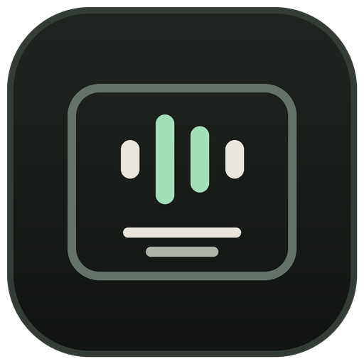

  

<h3 align="center">LyricFrame</h3>

  

**LyricFrame** crea videos con letra sincronizada en **9:16** y **16:9**. Carga tu audio, marca cuándo entra cada línea o importa un archivo LRC. Puedes cambiar el fondo, la tipografía y la animación antes de exportar a MP4 con FFmpeg o HyperFrames.

Para abrirlo en Windows, extrae el ZIP completo y ejecuta **Abrir LyricFrame.cmd**. [Guía de uso](README_GUIA.md)
